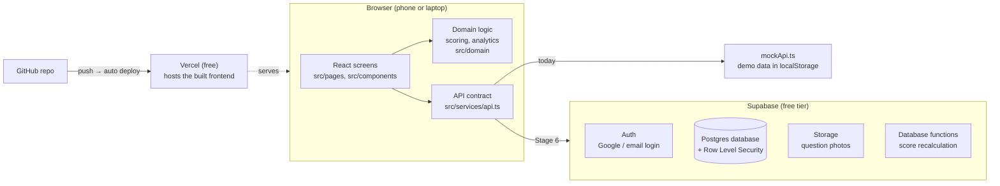
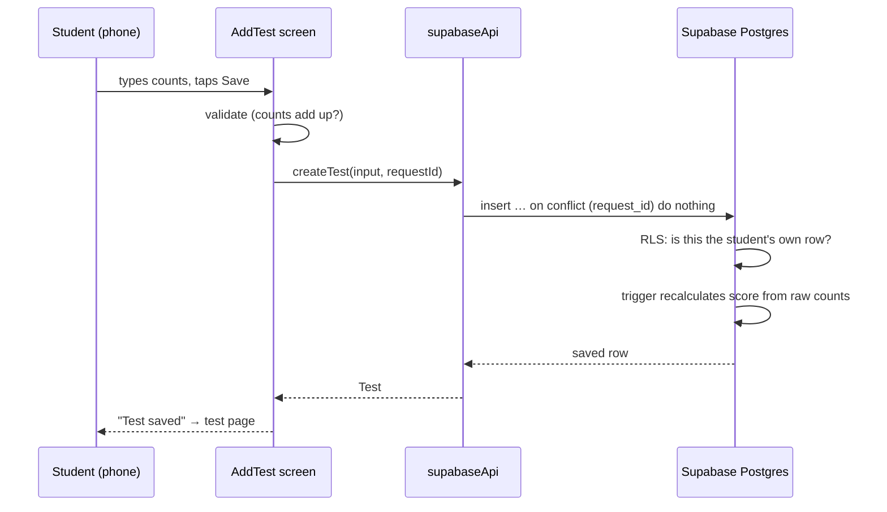

# 2. Architecture

## Components

## Layers inside the frontend

| Layer | Folder | Rule |
|-------|--------|------|
| Screens | `src/pages/` | Show data, handle clicks. No business rules. |
| Components | `src/components/` | Reusable pieces (buttons, charts, the score track). |
| Domain | `src/domain/` | Pure functions: scoring, analytics, labels. No React, no network. Tested. |
| Services | `src/services/` | The only code that talks to "the server". |
| Mock data | `src/mock/` | Demo data. Never used once real data exists. |

Why: when we connect Supabase, only `src/services/` changes. Screens and
scoring stay exactly as they are.

## Stack and why

| Layer | Choice | Rejected alternative | Why |
|-------|--------|----------------------|-----|
| UI | React 19 + TypeScript | Plain JS | Types catch mistakes before they reach a student's phone |
| Build | Vite | Next.js | No server rendering needed; simpler to learn and host |
| Styling | Tailwind CSS v4 | shadcn/ui kit | Our own small component set = distinctive look, fewer dependencies |
| Charts | Recharts | Chart.js | React-native API, responsive |
| Routing | React Router | — | Standard |
| Backend + DB | **Supabase** | Google Sheets + Apps Script (original proposal) | Real login, row-level permissions, proper relational DB, fast; Sheets has no real auth and is slow (1–3 s per call). See [decisions/0001](decisions/0001-supabase-instead-of-sheets.md) |
| Hosting | Vercel | Netlify | Free, auto-deploys from GitHub, `*.vercel.app` URL — no domain needed |

## Data flow: saving a test (after Stage 6)

## The three riskiest decisions

1. **Supabase free tier pauses after 7 days of no activity.** Mitigation: regular
   use prevents it; one click un-pauses; weekly CSV export as a backup.
2. **Security lives in database rules (RLS).** If a rule is wrong, data leaks.
   Mitigation: automated tests that sign in as each role and try forbidden things.
3. **Single region (Mumbai).** Fine for India; nothing to do.
