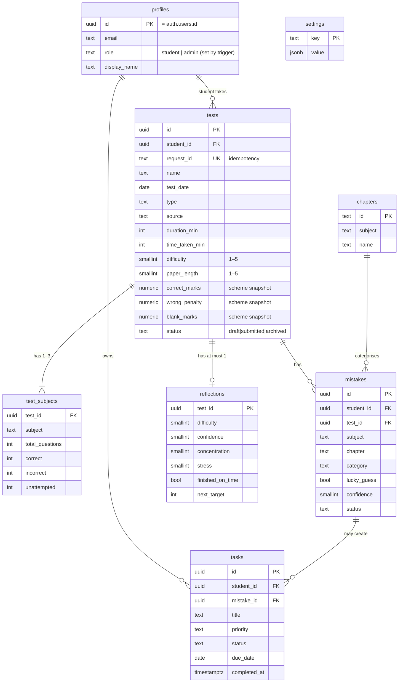

# 5. Database schema (Supabase / Postgres) — planned for Stage 6

Draft. It will be created through **migration files** in `supabase/migrations/`
(never by clicking in the dashboard), so every change is versioned in Git.



Every table also has `created_at` and `updated_at` (`timestamptz`, stored in UTC,
shown in IST).

## Rules enforced by the database (not just the app)
- `CHECK (correct + incorrect + unattempted = total_questions)` and all ≥ 0.
- `CHECK (difficulty BETWEEN 1 AND 5)` etc. for every rating.
- `UNIQUE (student_id, request_id)` → duplicate submissions impossible.
- **Scores are not stored as truth.** A view (`test_results`) computes score,
  negative marks, accuracy and attempt rate from raw counts × **the marking
  scheme saved on that test** (decision 0004).
- **Scheme snapshot.** When a test is inserted, a trigger copies the current
  scheme from `settings` into `correct_marks / wrong_penalty / blank_marks`.
  The browser can't set these. Changing Settings later never changes old scores.
- **Role from email.** A trigger on `auth.users` insert creates the `profiles`
  row; its role is `admin` only if the email is in the `admin_emails` table,
  otherwise `student`. Users can't update their own `role` (RLS + column grant).
- Foreign keys with `ON DELETE` rules; tests are **archived**, not deleted.
- Indexes on every foreign key and on `(student_id, test_date)`.

## Row Level Security (who can see what)
```sql
-- example: tests
alter table tests enable row level security;
create policy "student reads own"   on tests for select using (student_id = auth.uid());
create policy "admin reads all"     on tests for select using (is_admin());
create policy "student inserts own" on tests for insert with check (student_id = auth.uid());
create policy "student updates own" on tests for update using (student_id = auth.uid());
create policy "admin archives"      on tests for update using (is_admin()); -- archive function only
```
Mistakes, reflections and tasks get the same **read** policies, but only the
owning student can insert/update — the admin view is read-only (decision 0003).
Tests will sign in as each role and try forbidden things.

## Changes from the original Sheets schema
| Original | Now | Why |
|----------|-----|-----|
| `Users` tab | `profiles` + Supabase Auth | No passwords stored by us |
| Totals stored on `Tests` | Computed in a view | One source of truth: raw counts |
| `Subject_Scores` with scores | `test_subjects` with counts only | Same |
| `Attachments` tab | Supabase Storage + `image_path` on mistakes | Private bucket, signed URLs |
| Row numbers | UUIDs | Stable IDs |
