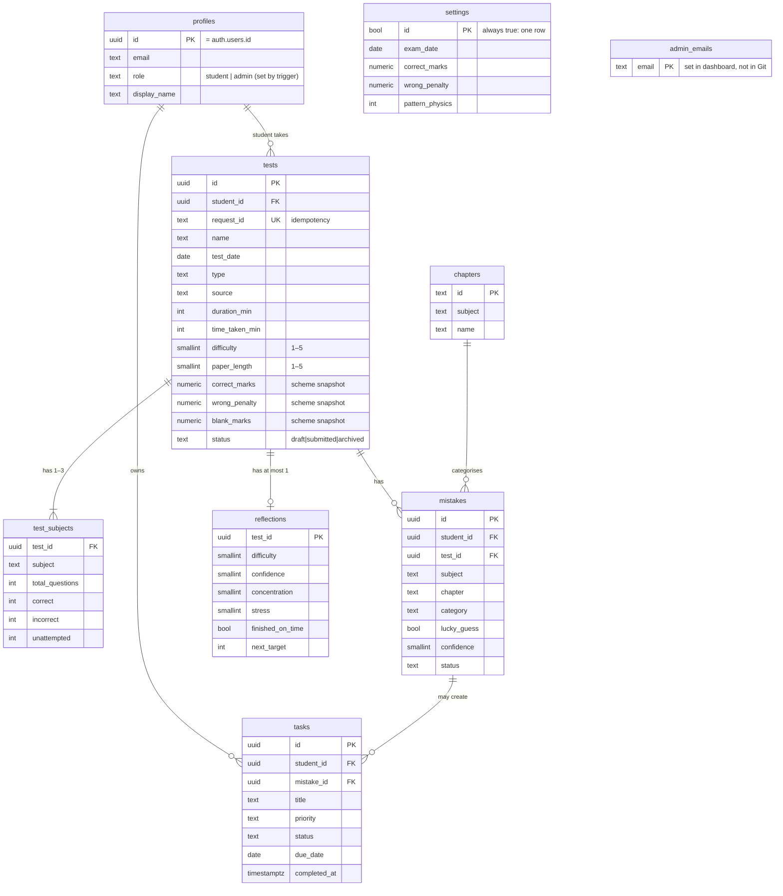

# 5. Database schema (Supabase / Postgres)

Created by **migration files** in [`supabase/migrations/`](../supabase/migrations/)
(never by clicking in the dashboard), so every change is versioned in Git:

| File | What it does |
|------|--------------|
| `…_initial_schema.sql` | Tables, CHECK rules, triggers, Row Level Security, app functions |
| `…_reference_data.sql` | Default settings row + 80 NCERT chapters (generated from `src/mock/chapters.ts`) |



Every table also has `created_at` and `updated_at` (`timestamptz`, stored in UTC,
shown in IST). There is no `max_marks`/`total` column anywhere — totals are
always worked out from the counts.

## Functions the app calls (RPC)
| Function | Who | What |
|----------|-----|------|
| `save_test(id, request_id, input)` | student | Creates (id = null) or updates a test **and** its subject rows in one transaction. Same `request_id` → returns the existing test |
| `archive_test(id)` | admin | Sets status to `archived` |
| `list_students()` | admin | One row per student: name, email, joined, test count, last activity |

Everything else (reading tests, logging mistakes, tasks, reflections, settings)
is plain table access, filtered by the RLS policies below.

## Rules enforced by the database (not just the app)
- `CHECK (correct + incorrect + unattempted = total_questions)` and all ≥ 0.
- `CHECK (difficulty BETWEEN 1 AND 5)` etc. for every rating.
- `UNIQUE (student_id, request_id)` → duplicate submissions impossible.
- **Scores are never stored.** The database keeps raw counts plus the scheme
  saved on each test; score, negative marks, accuracy and attempt rate are
  calculated by the tested functions in `src/domain/scoring.ts` (decision 0004).
  The browser can't send a score, so it can't send a wrong one.
- **Scheme snapshot.** When a test is inserted, a trigger copies the current
  scheme from `settings` into `correct_marks / wrong_penalty / blank_marks`.
  The browser can't set these. Changing Settings later never changes old scores.
- **Role from email.** A trigger on `auth.users` insert creates the `profiles`
  row; its role is `admin` only if the email is in the `admin_emails` table,
  otherwise `student`. Users can't update their own `role` (column grant:
  only `display_name` is updatable).
- **Same-student links.** A mistake or reflection must point at a test of the
  same student — enforced with a composite foreign key `(test_id, student_id)`.
- **`completed_at` follows `status`** on tasks (trigger), so it can't drift.
- Foreign keys with `ON DELETE` rules; tests are **archived**, not deleted.
- Indexes on every foreign key and on `(student_id, test_date)`.

## Row Level Security (who can see what)
```sql
-- example: tests
alter table tests enable row level security;
create policy "student reads own"   on tests for select using (student_id = auth.uid());
create policy "admin reads all"     on tests for select using (is_admin());
create policy "student inserts own" on tests for insert with check (student_id = auth.uid());
create policy "student updates own" on tests for update using (student_id = auth.uid());
create policy "admin archives"      on tests for update using (is_admin()); -- archive function only
```
Mistakes, reflections and tasks get the same **read** policies, but only the
owning student can insert/update — the admin view is read-only (decision 0003).
Archived tests can't be edited or un-archived by the student.

## How the rules were checked
The migrations were run in an in-memory Postgres (PGlite) with a small stand-in
for Supabase's `auth` schema, then 44 checks signed in as two students, the
admin and a signed-out visitor and tried allowed and forbidden things — e.g.
"student B can't read or edit A's test", "admin can't create tasks", "editing
an old test keeps its scheme", "counts that don't add up save nothing".

## Changes from the original Sheets schema
| Original | Now | Why |
|----------|-----|-----|
| `Users` tab | `profiles` + Supabase Auth | No passwords stored by us |
| Totals stored on `Tests` | Computed in a view | One source of truth: raw counts |
| `Subject_Scores` with scores | `test_subjects` with counts only | Same |
| `Attachments` tab | Supabase Storage + `image_path` on mistakes | Private bucket, signed URLs |
| Row numbers | UUIDs | Stable IDs |
